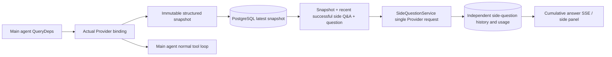

# ARTEX `/btw`

Ordinary chats, the task MainAgent and the current task's own Workers support independent side questions. Type `/btw question` in the main input box to submit; an empty `/btw` or the "Side question" button opens the history. Desktop uses a resizable side panel, mobile uses a Drawer.

Side answers are generated from the agent context snapshot taken at submission, and support streaming display, follow-ups, stop and clear. Closing the panel, reloading the page or dropping the SSE connection does not cancel the model request. Stop only affects the current side question; clear cancels the side question and deletes the side-question history while keeping the main context snapshot.

## Implementation boundary

Reuses Go, norma v0.3.7, Next.js and the existing Markdown / ResizablePanel / Drawer / AlertDialog components; norma's source was not modified and no dependency was added for side questions. The Planner, Workers inherited from other tasks and tool-style subtask upgrades are out of scope.

- `capture.go` only tags main-loop requests in `Options.Deps.CallModel / CallModelSync`. The Provider decorator sits inside the concrete model, after the routing pool's outer selection, so it records the model actually selected; compaction and summary requests do not overwrite the snapshot.
- Snapshots are published at request start, on a complete model reply and at the run's terminal state. A half-generated reply is never published; tool calls stay paired through norma's `MessagesForAPI`, and tool results enter the snapshot at the next main model request or at the terminal state. An aborted stream keeps the previous valid boundary.
- Snapshots are JSON deep copies that keep structured messages, system prompts, tool definitions and generation parameters. Model inference holds no snapshot lock or database transaction.
- `SideQuestionService` calls the concrete Provider; when needed it first generates a side-question summary, and the final answer may be retried once after reduction only when the context first exceeds the limit and no text/tool call has been output yet. It creates no agent session and is not wired into the tool executor, main transcript, activity stream or task graph, nor does it go through the task model switch chain. Answers keep tool definitions for compatibility with existing structured tool context; summary requests provide no tools. Newly returned tool calls have no execution path.
- One running request per parent conversation, at most four per service process, with a 120-second timeout per request. Side questions use an independent cancellation context tied to the service lifetime.
- Side-question requests keep a model config reference and a non-sensitive identity digest; credentials are taken from the existing config at request time. If the config is deleted, or identity fields such as model, protocol or address change, the main agent must run first to refresh the snapshot. Tests never change the product's default model.

## Persistence and recovery

`db/schema.sql` creates `side_question_sessions` and `side_question_requests` automatically. The former stores the parent resource, latest snapshot, run ID, version and clear version; the latter stores the question, cumulative answer, status, model, snapshot time, usage, event sequence and page ordinal.

The parent conversation key is the conversation ID, or task ID + exploration ID + intent ID. Workers do not use reusable execution slot names.

Snapshots are merged per parent conversation and flushed every 250 ms; the database compares `(run_id, version)` to prevent older versions from overwriting. The selected snapshot is saved again before a side question is submitted. Once saved successfully the large in-memory snapshot is released; on failure the pending version is kept. Cumulative answer content is written at most every 250 ms as streaming events arrive; the terminal state is saved immediately with limited retries on database errors.

On startup the service marks leftover `running` requests as `interrupted`, keeping the partial answer and usage already stored, and does not replay requests automatically. The most recently saved context can be used directly for the next question. When an old conversation has no snapshot the main agent must run first; context is never rebuilt from UI activity records.

Clear increments the clear version and deletes requests; conditional updates stop late callbacks from writing back. Physical deletion of the parent resource relies on foreign key cascades; logical deletion of a Worker removes side-question data in the same transaction and rejects later late snapshots. Task archiving first blocks new requests, waits for the main flow to stop, then cancels and waits for side questions to be stored; the archive format is v3 and stays compatible with v1/v2 without side-question tables.

History is stored in full and returned at most 20 rows per page by ordinal cursor. Model requests replay at most the 20 most recent successful Q&A pairs verbatim, also bounded by a token budget; older Q&A pairs keep an independent rolling summary. When the main context exceeds the budget only the old part of the side-question copy is summarized, keeping recent structured tool calls and results. Summaries and preparation progress count toward the side question's concurrency, cancellation and 120-second timeout limits together with usage. See [Context budget and open-source references](CONTEXT_BUDGET.md).

## HTTP contract

The following paths serve as `{parent}`, reusing the existing authentication and resource checks:

- `/api/conversations/{id}`
- `/api/tasks/{id}/chat`
- `/api/tasks/{id}/intents/{iid}`

| Request | Response and behaviour |
| --- | --- |
| `GET {parent}/side-questions?before={ordinal}` | `items` ordered newest to oldest, a separate `current` run state, `snapshot` metadata and `next_cursor`; a cursor of 0 means the latest page / no next page |
| `POST {parent}/side-questions` | JSON `{ "question": "…", "client_request_id": "UUID" }`; a new request returns 202 with the request object; the same ID and question returns the existing object with 200 |
| `DELETE {parent}/side-questions` | Cancels and clears the side questions of the current parent conversation |
| `GET /api/side-questions/{requestID}/events` | `snapshot` SSE events, `id` is an increasing sequence and `data` is the full cumulative request object; `cleared` is sent on clear |
| `POST /api/side-questions/{requestID}/cancel` | Explicit cancel; the terminal state can be read from history or SSE |

Questions are limited to 4000 characters. No snapshot, a changed model config, a busy parent conversation or an idempotency ID conflict returns 409; the global concurrency limit returns 429. Every SSE connection first sends the cumulative state and does not rely on text fragments the client received earlier. The frontend merges by request ID + sequence and discards stale callbacks when switching parent conversations or clearing.

## Validation and references

Automated checks, real model usage and known limitations are in [VALIDATION.md](VALIDATION.md).

The independent request follows [Grok CLI side-question.ts (pinned commit)](https://github.com/superagent-ai/grok-cli/blob/fb97af83f06dca873281d60168430f06c8de6324/src/utils/side-question.ts), and run isolation follows [OpenCode (pinned commit)](https://github.com/anomalyco/opencode/tree/b3f1a96c6dd7adeb28b36dd11add1998fc84d67b). ARTEX's context uses norma's structured messages rather than stitching text together from frontend logs.
