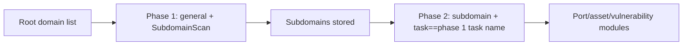

# ScopeSentry MCP Usage Guide

For users with an **already deployed ScopeSentry instance**. Connect to the platform through Cursor (or another MCP client); no local source code is required.

## 1. Preparation

### 1.1 Confirm the service is reachable

- Default web UI: `http://<host>`
- MCP endpoint: `http://<host>/mcp` (if a reverse proxy or frontend proxy sits in front, use the actual `/mcp` address)

### 1.2 Create an API Key

1. Log in to the ScopeSentry web UI in a browser
2. Open the **API Key** management page and create a key (or create one through an endpoint provided by the administrator)
3. Save the returned `ssk_...` string (**shown only once**)

### 1.3 Configure the Cursor MCP

Cursor → Settings → MCP → Add server:

```json
{
  "mcpServers": {
    "scopesentry": {
      "url": "http://<your-host>:8082/mcp",
      "headers": {
        "X-API-Key": "ssk_your_key"
      }
    }
  }
}
```

You can also use: `Authorization: Bearer ssk_your_key`

After configuring, restart the MCP or reload Cursor and confirm that tools such as `list_projects` and `list_assets` appear in the tool list.

---

## 2. Tool overview


| Tool                   | Purpose                                         |
| ---------------------- | ----------------------------------------------- |
| `list_projects`        | Project tree grouped by tag (with project IDs)  |
| `list_projects_data`   | Paginated project list, searchable by name      |
| `get_project`          | Project details                                 |
| `create_project`       | Create a project                                |
| `list_tasks`           | Scan task list                                  |
| `get_task`             | Task details                                    |
| `list_scan_templates`  | Scan template list                              |
| `get_scan_template`    | Template details                                |
| `list_plugin_modules`  | Scan pipeline module names                      |
| `list_plugins`         | Available plugins (with hash, default parameters) |
| `create_scan_template` | Create a scan template                          |
| `create_scan_task`     | Create a scan task                              |
| `list_assets`          | Query assets of all types (paginated list)      |
| `count_assets`         | Count assets (`/api/assets/common/total`)       |
| `get_asset_detail`     | Asset or vulnerability details                  |
| `add_asset_tag`        | Add a tag to an asset                           |
| `list_nodes`           | Scan node list                                  |


The MCP tool descriptions (schemas) are authoritative for each tool's parameters. `list_assets` and `count_assets` share the same search and filter syntax; read the `list_assets` description before querying assets.

When you need to know "how many in total", use `count_assets` (the web UI's pagination total endpoint) instead of paging through `list_assets` repeatedly just to count.

---

## 3. Common workflows

### 3.1 Query assets by project

When the user or the context **already has a project condition**, prefer adding `filter.project` to narrow the scope and avoid slow responses caused by too much cross-project data. If there is no clear project, a project filter is not mandatory.

1. Use `list_projects` or `list_projects_data` to get the target project's **ObjectID** (`id` / `children[].value`)
2. Pass `filter.project` to `list_assets` (**it must be the ID, not the project's display name**)

```json
{
  "asset_type": "asset",
  "pageIndex": 1,
  "pageSize": 20,
  "search": "domain=^example.com",
  "filter": {
    "project": ["<project ObjectID>"]
  }
}
```

### 3.2 Create a scan task

1. `list_nodes` to get online node names
2. `list_scan_templates` or `create_scan_template` to get the template **ObjectID**
3. `create_scan_task`: `name` and `node` are required; `template` takes the template ID (not the template name)

**Target source `targetSource` (same as the web UI):**

| targetSource | Description | Required parameters |
| --- | --- | --- |
| `general` | Enter targets directly | `target` |
| `project` | Read targets from projects | `project` (array of project ObjectIDs) |
| `asset` | Search the web asset store | `search`; optional `project`, `filter`, `targetNumber` |
| `RootDomain` | Search the root domain store | `search`; optional `project`, `filter`, `targetNumber` |
| `subdomain` | Search the subdomain store | `search`; optional `project`, `filter`, `targetNumber` |
| `UrlScan` | Search URL scan results | `search`; optional `project`, `filter`, `targetNumber` |
| `*Source` (e.g. `subdomainSource`) | Created from "select/search" on an asset page | `search` when `targetTp=search`; `targetIds` when `targetTp=select` |

**Example — scan root domains directly:**

```json
{
  "name": "example-subdomain-collection",
  "node": ["node-1"],
  "template": "<template ObjectID>",
  "targetSource": "general",
  "target": "example.com\nfoo.com",
  "project": ["<project ObjectID>"]
}
```

**Example — continue from the subdomain store (filtered by the previous task name):**

```json
{
  "name": "example-ports-and-vulns",
  "node": ["node-1"],
  "template": "<follow-up module template ObjectID>",
  "targetSource": "subdomain",
  "search": "task==\"example-subdomain-collection\"",
  "project": ["<project ObjectID>"]
}
```

### 3.3 Full information gathering for root domains (two phases recommended)

When the input is a **root domain** and you need **full information gathering**, split it into two scans instead of running the whole pipeline at once.

**Why:** distributed tasks are dispatched per **single target**. When a root domain is the target, the node that receives it also runs every follow-up module for the subdomains it discovers, which causes uneven load, slow scans, and errors.

**Best practice:**

1. **Phase 1 — subdomain collection only**
   - `targetSource`: `general`
   - `target`: all root domains (one per line)
   - Template: enable only `SubdomainScan` and `SubdomainSecurity` (subdomain scan + subdomain takeover)
   - Use `get_task` to wait for the task to finish

2. **Phase 2 — follow-up modules**
   - `targetSource`: `subdomain`
   - `search`: `task=="<phase 1 task name>"` (exact task name match)
   - Optional `project` to narrow the scope
   - Template: port scan, asset mapping, vulnerability scan, etc. (SubdomainScan can be omitted)
   - Subdomains are dispatched to nodes as independent targets, so parallelism is much better

You can also filter the "Subdomain" asset page in the web UI by task name and use "Create task from subdomains"; the effect is the same.



### 3.4 Create a scan template

1. `list_plugin_modules` → list of module names
2. `list_plugins` (filterable by `module`) → each plugin's `hash` and default `parameter`
3. `create_scan_template`: use `modules` to map "module → array of plugin hashes"

---

## 4. Asset queries (`list_assets` / `count_assets`)

`count_assets` uses the same `asset_type`, `search`, and `filter` as `list_assets` and returns `{ "total": N }`, matching the web UI's `/api/assets/common/total`.

```json
{
  "asset_type": "subdomain",
  "search": "task==\"<task name>\"",
  "filter": {"project": ["<project ObjectID>"]}
}
```

**Performance tips (apply to both `list_assets` and `count_assets`):** with a project condition, prefer `filter.project` to narrow the scope; in `search`, use `==` exact match or `^` prefix match on indexed fields where possible (see [4.3](#43-search-expressions)) and avoid broad `=` fuzzy queries that slow responses down. Without project context, a project filter is not mandatory.

See the table in [4.4](#44-filter-exact-filtering) for the types that support `filter.project`.

### 4.1 Asset types `asset_type`

`asset`, `RootDomain`, `subdomain`, `app`, `mp`, `UrlScan`, `SensitiveResult`, `DirScanResult`, `crawler`, `vulnerability`, `PageMonitoring`, `IPAsset`, `SubdomainTakerResult`

Alias examples: `web`→asset, `vuln`→vulnerability, `ip`→IPAsset, `url`→UrlScan

### 4.2 Parameters


| Parameter                | Description                                               |
| ------------------------ | --------------------------------------------------------- |
| `pageIndex` / `pageSize` | Pagination, default 1 / 20                                |
| `search`                 | Search expression (see next section)                      |
| `filter`                 | Exact-filter JSON (see below)                             |
| `sort`                   | Only UrlScan and DirScanResult support sorting by `length` |
| `sid`                    | SensitiveResult only: sensitive rule name                 |


`search` and `filter` **can be used together**.

### 4.3 search expressions

A custom DSL (**not SQL**):


| Operator | Meaning | Index | Example                     |
| ---- | ---- | ---- | --------------------------- |
| `=`  | Fuzzy match (regex) | No index | `domain=example`            |
| `==` | Exact match (equality) | **Uses index** | `port==443`                 |
| `!=` | Exclude | — | `port!="80"`                |
| `&&` | AND  | — | `domain==example.com && port==443` |
| `||` | OR   | — | `title=admin || body=login` |


**Indexes and operators:** fields such as `domain`, `ip`, `port`, and `title` are indexed, but only **`==` exact match** or **prefix match with a value starting with `^`** (e.g. `domain=^example.com`) can use the index; **`=` becomes a regex fuzzy match and cannot use the index**, so it gets slow on large data sets.

**search fields common to all types:** `tag`, `task` (task name), `rootDomain`

**project cannot be used in search** (it is ignored, or errors when combined with `&&`). Use `filter.project` to filter by project.

**Common search fields per type:**


| asset_type           | Fields                                                                              |
| -------------------- | ----------------------------------------------------------------------------------- |
| asset                | domain, ip, port, service, app, title, statuscode, icon, banner, type, body, header |
| RootDomain           | domain, icp, company                                                                |
| subdomain            | domain, ip, type, value                                                             |
| app                  | name, icp, company, category, description, url, apk                                 |
| mp                   | name, icp, company, category, description, url                                      |
| UrlScan              | url, input, source, resultId, type                                                  |
| SensitiveResult      | url, sname, body, info, md5                                                         |
| DirScanResult        | url, statuscode, redirect, length                                                   |
| vulnerability        | url, vulname, matched, request, response, level                                     |
| crawler              | url, method, body, resultId                                                         |
| PageMonitoring       | url, hash, diff, response                                                           |
| IPAsset              | ip, domain, port, service, webServer, app                                           |
| SubdomainTakerResult | domain, value, type, response                                                       |


**search examples:**

- `domain==www.example.com && port==443` (exact, uses index)
- `domain=^example.com` (prefix match, uses index)
- `ip==192.168.1.1`
- `task=="<task name>"`
- `level==high` (vulnerability)
- `statuscode==200` (DirScanResult)

Use `=` only when you need a fuzzy contains match, e.g. `title=admin` (no index; combine it with a project or other condition to narrow the scope).

### 4.4 filter exact filtering

A JSON object: multiple values for the same key are **OR**, different keys are **AND**.

**Prefer `project` when there is a project condition:** if the user or context has identified a project and the asset_type supports `project`, include it to narrow the scope; it is not mandatory without project information.


| filter key   | Meaning           | Values                                                         |
| ------------ | ----------------- | -------------------------------------------------------------- |
| `project`    | Owning project    | **ObjectID**, from `list_projects` / `list_projects_data`      |
| `task`       | Source task       | **Task name**, the `name` from `list_tasks`                    |
| `port`       | Port              | e.g. `"443"`                                                   |
| `service`    | Service/protocol  | e.g. `"https"`                                                 |
| `app`        | App fingerprint   | e.g. `"Nginx"`                                                 |
| `icon`       | Icon hash         |                                                                |
| `statuscode` | HTTP status code  | Mainly for asset                                               |
| `status`     | Status            | UrlScan/DirScan HTTP code; handling status of vulnerabilities/sensitive info |
| `level`      | Vulnerability level | critical / high / medium / low / info                        |
| `type`       | Type              | e.g. subdomain record types A, CNAME                           |
| `color`      | Sensitive rule color | SensitiveResult                                             |
| `sname`      | Sensitive rule name | SensitiveResult                                              |
| `tags`       | Tags              |                                                                |


**Available filter keys per type:**


| asset_type                            | filter key                                                      |
| ------------------------------------- | --------------------------------------------------------------- |
| asset                                 | project, port, service, app, icon, statuscode, type, task, tags |
| RootDomain                            | project, tags                                                   |
| subdomain                             | project, type, task, tags                                       |
| app / mp                              | project, tags                                                   |
| UrlScan                               | status, tags                                                    |
| DirScanResult                         | status, tags                                                    |
| SensitiveResult                       | status, color, sname, tags                                      |
| crawler                               | project, task, tags                                             |
| vulnerability                         | project, level, status, task, tags                              |
| PageMonitoring / SubdomainTakerResult | tags                                                            |
| IPAsset                               | project, port, service, app                                     |


**filter example:**

```json
{"project": ["<project ObjectID>"], "port": ["443"]}
```

**Combined query example:**

```json
{
  "asset_type": "asset",
  "search": "domain=^baidu && port==443",
  "filter": {"project": ["<project ObjectID>"]},
  "pageIndex": 1,
  "pageSize": 10
}
```

**Notes:**

- With a project condition, prefer `filter.project` (where supported); without project context it is not mandatory
- Do not put the project display name in `filter.project`
- Use `==` for known values and `^` for prefixes; avoid overusing `=` fuzzy matching on large tables
- For UrlScan HTTP status use `filter.status`; for DirScanResult you can use `statuscode==200` in search
- SensitiveResult by rule name: `sname=<rule name>` in `search`, or `filter.sname`

### 4.5 Sorting with sort

Supported only by **UrlScan** and **DirScanResult**:

```json
{"length": "ascending"}
```

Other types ignore `sort` and use the default time ordering.

---

## 5. Scan template module names

`TargetHandler`, `SubdomainScan`, `SubdomainSecurity`, `PortScanPreparation`, `PortScan`, `PortFingerprint`, `AssetMapping`, `AssetHandle`, `URLScan`, `WebCrawler`, `URLSecurity`, `DirScan`, `VulnerabilityScan`, `PassiveScan`

---

## 6. Troubleshooting


| Symptom   | Fix                                                |
| --------- | -------------------------------------------------- |
| MCP shows no tools | Check the URL, the API Key, and that ScopeSentry is running |
| 401 / 403 | Recreate or replace the API Key                    |
| Assets not found | Confirm `filter.project` is an ObjectID; do not put project in search |
| Template/task creation fails | `template` must be the template ObjectID; `node` must be an online node name |
| Queries slow or hanging | Add `filter.project` when there is a project; in search use `==` or a `^` prefix on indexed fields and avoid `=`; reduce `pageSize` |


---
